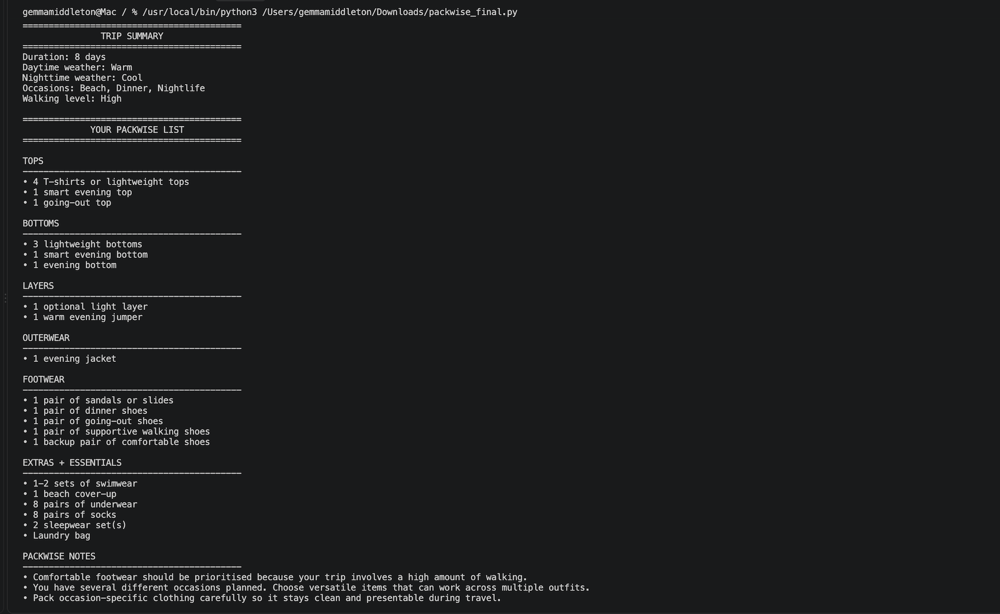
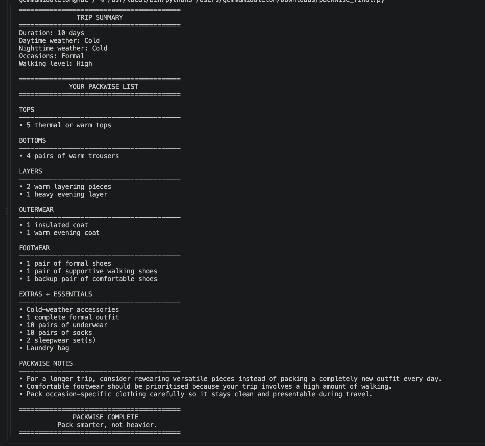
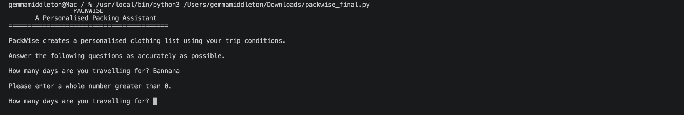

# PackWise

### A Personalised Packing Assistant

PackWise is a Python command-line prototype that generates a personalised clothing packing list from five trip inputs: **trip duration, daytime weather, nighttime weather, planned occasions and walking level**.

Rather than returning the same checklist for every traveller, PackWise validates the user's responses and applies conditional rules to build recommendations across separate clothing categories.

## Core Features

- Validates user input
- Processes separate daytime and nighttime weather
- Accepts multiple planned occasions
- Calculates clothing quantities from trip duration
- Creates categorised packing recommendations
- Adjusts footwear recommendations according to walking level
- Produces contextual packing notes
- Uses no external Python libraries

## Technologies

- Python 3
- Visual Studio Code
- Git
- GitHub

## How PackWise Works

```text
User Input
    ↓
Input Validation
    ↓
Stored Trip Data
    ↓
Quantity Calculations
    ↓
Conditional Decision Rules
    ↓
Packing Categories
    ↓
Personalised Packing Notes
    ↓
Final Packing List
```

## Python Concepts Demonstrated

PackWise uses:

- variables and data types
- `if`, `elif` and `else`
- `while` and `for` loops
- lists and `.append()`
- string methods including `.lower()`, `.strip()` and `.split()`
- functions
- parameters and return values
- arithmetic
- input validation

## Development Process

Earlier versions are retained in `development_versions/`.

### Week 1 — Basic Inputs
Introduced `print()`, `input()`, variables and a basic trip summary.

### Week 2 — Input Validation
Introduced validation loops, `.isdigit()`, integer conversion, `.lower()` and `.strip()`.

### Week 3 — Conditional Recommendations
Introduced packing categories, lists, `.append()`, loops and conditional recommendation rules.

### Week 4 — Quantities and Multiple Occasions
Introduced trip-based quantities, `.split()`, multiple occasion processing and duplicate handling.

### Week 5 — Functions
Reorganised the prototype into functions with parameters and return values.

### Final Version
Integrates validation, quantities, multiple occasions, separate day/night logic, functions, contextual packing notes and formatted output.

## Repository Structure

```text
PackWise/
├── README.md
├── .gitignore
├── final/
│   └── packwise_final.py
├── development_versions/
│   ├── week_01_basic_inputs/
│   ├── week_02_input_validation/
│   ├── week_03_conditional_logic/
│   ├── week_04_quantities_and_occasions/
│   └── week_05_functions/
├── testing/
│   ├── test_matrix.md
│   └── screenshots/
├── screenshots/
└── references/
    └── references.md
```

## How to Run PackWise

1. Download or clone the repository.
2. Open the repository in Visual Studio Code.
3. Open `final/packwise_final.py`.
4. Run the Python file.
5. Answer the questions in the terminal.
6. PackWise will display the personalised packing list.

## Example Input

```text
Trip duration: 8 days
Daytime weather: warm
Nighttime weather: cool
Occasions: beach, dinner, nightlife
Walking level: high
```


## Screenshots

### Final Multi-Occasion Output

This example demonstrates an eight-day trip with warm daytime weather, cool nights, three planned occasions and a high walking level.



### Contrasting Cold / Formal Trip

This test demonstrates that changing the trip conditions produces a substantially different packing list, including thermal clothing, warm outerwear, formal clothing and supportive footwear.



### Input Validation

This example shows PackWise rejecting an invalid trip-duration response and prompting the user to enter a whole number greater than zero.



## Testing

Testing includes:

- short hot-weather trips
- long cold-weather trips
- multiple occasions
- high walking levels
- invalid trip duration
- unsupported weather values

See `testing/test_matrix.md`.

## Project Status

**Complete prototype**

PackWise is a functional Python CLI prototype designed to demonstrate personalised decision logic rather than commercial-level interface development.

## Limitations

- Weather is entered manually.
- Recommendations use predefined rules.
- Destination-specific climate and cultural requirements are not automatically included.
- Laundry access, personal style and luggage-size limits are not direct user inputs.
- The prototype runs through a command-line interface.

## Future Development

Possible extensions include:

- live weather data
- destination-based climate information
- laundry-access input
- additional activity categories
- personal clothing preferences
- luggage-size constraints
- saved packing lists
- graphical interface development

## Development Resources

Technical and conceptual sources are documented in `references/references.md`.

## Author

**Gemma Middleton**

PackWise — Creative Coding Project
